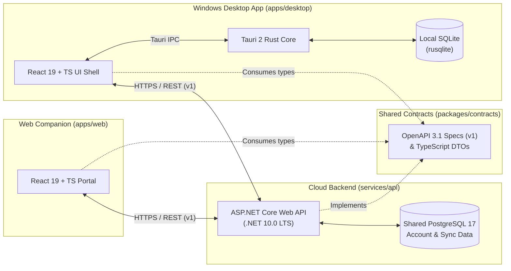

# FlowPilot Architecture Overview

FlowPilot is designed as an **offline-first personal AI dictation product** with a native Windows desktop application (`apps/desktop`), a web companion portal (`apps/web`), and an ASP.NET Core Web API (`services/api`).

---

## 1. High-Level Topology

---

## 2. Storage & Data Boundaries

A core architectural invariant of FlowPilot is the strict separation between **desktop-local operational persistence** and **shared account persistence**:

| Concern                | Desktop Local Store (`SQLite`)                                                         | Shared Cloud Store (`PostgreSQL`)                                              |
| :--------------------- | :------------------------------------------------------------------------------------- | :----------------------------------------------------------------------------- |
| **Owner**              | `apps/desktop/src-tauri` (`rusqlite`)                                                  | `services/api` (`FlowPilot.Api` + EF Core `Npgsql`)                            |
| **Network Dependency** | Zero — works 100% offline                                                              | Requires network connectivity to `FlowPilot.Api`                               |
| **Stored Data**        | Local dictation session history, hotkeys, audio device preferences, pending sync queue | Account profile, cross-device custom vocabulary/dictionary, subscription state |
| **Privacy Boundary**   | Raw audio and unconfirmed local transcripts stay on-device                             | Only user-authorized account metadata and synced dictionary items are stored   |

---

## 3. Explicit & Versionable API Contracts

All HTTP communication between `apps/desktop`, `apps/web`, and `services/api` is governed by `packages/contracts`:

1. **Versioned OpenAPI Specification**:
   - Located at `packages/contracts/openapi/v1/openapi.yaml`.
   - Served dynamically by `FlowPilot.Api` at `/openapi/v1.json`.
2. **Versioned Route Prefix**:
   - Application endpoints are grouped under `/api/v1/*` (e.g., `/api/v1/health`).
   - Infrastructure-level health probes are exposed at `/health`.
3. **Contract Evolution Policy**:
   - Additive, backward-compatible fields may be added to `v1` schemas when marked optional.
   - Any breaking change to request/response structures requires introducing a `v2` specification (`packages/contracts/openapi/v2/openapi.yaml`) and `/api/v2/*` route group.

---

## 4. Independent Buildability

Each workspace in the monorepo is designed to build and test independently:

- **`packages/contracts`**: Compiles standalone with `tsc` and validates OpenAPI YAML structure via Vitest.
- **`apps/web`**: Builds with Vite + React + TypeScript using `@flowpilot/contracts`.
- **`apps/desktop`**:
  - The frontend shell (`apps/desktop/src`) builds and tests with Vite + Vitest on any machine with Node.js.
  - The native Windows container (`apps/desktop/src-tauri`) compiles with `cargo` / Tauri CLI and embeds bundled SQLite (`rusqlite`).
- **`services/api`**: Builds and runs xUnit integration tests via `dotnet test FlowPilot.slnx` without requiring external services or live credentials.
