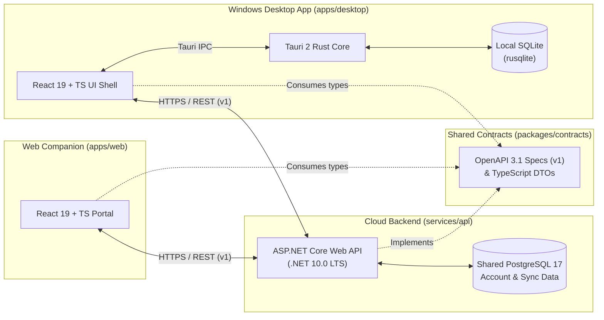
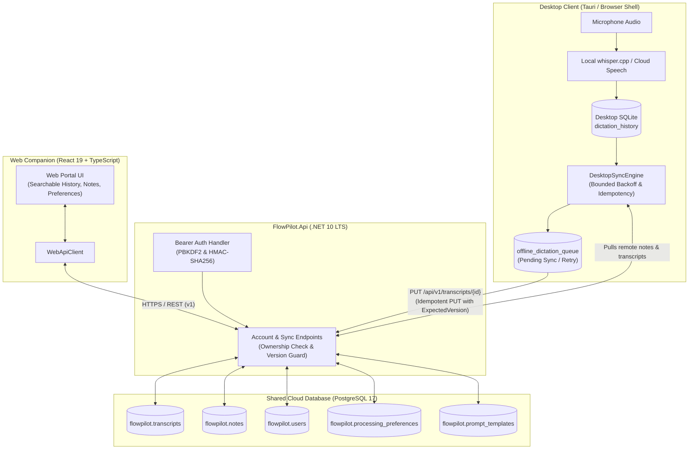

# FlowPilot Architecture Overview

FlowPilot is designed as an **offline-first personal AI dictation product** with a native Windows desktop application (`apps/desktop`), a web companion portal (`apps/web`), and an ASP.NET Core Web API (`services/api`).

---

## 1. High-Level Topology

---

## 2. Storage & Data Boundaries

A core architectural invariant of FlowPilot is the strict separation between **desktop-local operational persistence** and **shared account persistence**:

| Concern                | Desktop Local Store (`SQLite`)                                                         | Shared Cloud Store (`PostgreSQL`)                                              |
| :--------------------- | :------------------------------------------------------------------------------------- | :----------------------------------------------------------------------------- |
| **Owner**              | `apps/desktop/src-tauri` (`rusqlite`)                                                  | `services/api` (`FlowPilot.Api` + EF Core `Npgsql`)                            |
| **Network Dependency** | Zero — works 100% offline                                                              | Requires network connectivity to `FlowPilot.Api`                               |
| **Stored Data**        | Local dictation session history, hotkeys, audio device preferences, pending sync queue | Account profile, cross-device custom vocabulary/dictionary, subscription state |
| **Privacy Boundary**   | Raw audio and unconfirmed local transcripts stay on-device                             | Only user-authorized account metadata and synced dictionary items are stored   |

---

## 3. Explicit & Versionable API Contracts

All HTTP communication between `apps/desktop`, `apps/web`, and `services/api` is governed by `packages/contracts`:

1. **Versioned OpenAPI Specification**:
   - Located at `packages/contracts/openapi/v1/openapi.yaml`.
   - Served dynamically by `FlowPilot.Api` at `/openapi/v1.json`.
2. **Versioned Route Prefix**:
   - Application endpoints are grouped under `/api/v1/*` (e.g., `/api/v1/health`).
   - Infrastructure-level health probes are exposed at `/health`.
3. **Contract Evolution Policy**:
   - Additive, backward-compatible fields may be added to `v1` schemas when marked optional.
   - Any breaking change to request/response structures requires introducing a `v2` specification (`packages/contracts/openapi/v2/openapi.yaml`) and `/api/v2/*` route group.

---

## 4. Desktop Dictation Vertical Slice Architecture

Inside `apps/desktop/src/dictation`, responsibilities are strictly isolated behind typed interfaces (`types.ts`):

- **Audio Capture (`audioCapture.ts`)**: `BrowserMediaAudioCaptureService` requests microphone access (`getUserMedia`), records audio via `MediaRecorder`, stops hardware tracks immediately upon completion or cancellation, and never retains or persists raw audio buffers after transcription completes.
- **Speech Provider (`transcriptionProvider.ts`)**: `TranscriptionProvider` defines the provider-agnostic transcription contract with `AbortSignal` cancellation support. Phase 2 implements `OpenAiWhisperTranscriptionProvider` (`whisper-1` via `https://api.openai.com/v1/audio/transcriptions`) and documents `TranscriptionProviderRegistry` for adding future providers (e.g., local `whisper.cpp`, Azure AI Speech, Deepgram) without coupling UI components to provider SDKs.
- **Text Refinement (`textRefinement.ts`)**: `DeterministicTextRefinementService` transforms transcripts into five output modes (**Raw Transcription**, **Clean Text**, **Professional Message**, **Coding Prompt**, and **Quick Note**) while always preserving `originalTranscript` separately from `refinedTranscript` and `editedText`.
- **Clipboard (`clipboardService.ts`)**: `SystemClipboardService` copies edited text to the Windows clipboard with explicit failure handling (`CLIPBOARD_FAILED`).
- **History Persistence (`historyRepository.ts` & `src-tauri/src/db.rs`)**: `LocalDictationHistoryRepository` persists transcripts (original, refined, and edited text—never raw audio) to bundled SQLite via Tauri commands (`save_dictation_entry`, `list_dictation_history`, `delete_dictation_entry`) or browser local storage when running in the Vite development shell.
- **Workflow Controller (`dictationController.ts`)**: Manages deterministic state transitions (`idle`, `requesting-permission`, `permission-denied`, `recording`, `stopping`, `processing`, `cancelled`, `success`, `error`) and propagates `AbortController` cancellation across async operations.

---

## 5. Independent Buildability

Each workspace in the monorepo is designed to build and test independently:

- **`packages/contracts`**: Compiles standalone with `tsc` and validates OpenAPI YAML structure via Vitest.
- **`apps/web`**: Builds with Vite + React + TypeScript using `@flowpilot/contracts`.
- **`apps/desktop`**:
  - The frontend shell (`apps/desktop/src`) builds and tests with Vite + Vitest on any machine with Node.js.
  - The native Windows container (`apps/desktop/src-tauri`) compiles with `cargo` / Tauri CLI and embeds bundled SQLite (`rusqlite`).
- **`services/api`**: Builds and runs xUnit integration tests via `dotnet test FlowPilot.slnx` without requiring external services or live credentials.

---

## 6. Shared History & Offline Synchronization Architecture (Phase 4)

Phase 4 establishes cross-device sync between Windows Desktop and Web Companion via the ASP.NET Core API and PostgreSQL:

### Key Synchronization Invariants

1. **Privacy-Preserving Opt-In**:
   - Synchronization is strictly opt-in (`syncTranscriptsToCloud`).
   - Only transcript text, mode, duration, and device metadata leave the device. **Raw microphone audio is never synchronized.**
2. **Optimistic Version Concurrency**:
   - Each transcript and note carries a monotonically increasing integer `version`.
   - Updates must specify `expectedVersion`. Concurrent edits yield `HTTP 409 Conflict` with `VERSION_CONFLICT`.
   - The desktop client provides explicit resolution options: **Keep Local Edit** (rebases onto server version) or **Accept Server Version**.
3. **Idempotency & Resilient Retry**:
   - Every mutation payload includes a client-generated UUID `idempotencyKey`.
   - Duplicate deliveries due to network retries return success with the existing record rather than duplicating entries.
   - Offline retries use bounded exponential backoff (`min(maxBackoff, baseBackoff * 2^(attempt - 1))`) capped at 30 seconds.
4. **Deliberate Deletion Policy**:
   - `DELETE ?permanent=false` soft-deletes with tombstones (`is_deleted = true`, `deleted_at_utc`), allowing multi-device synchronization to detect deleted records.
   - `DELETE ?permanent=true` executes a hard purge to support personal privacy and compliance deletion.
